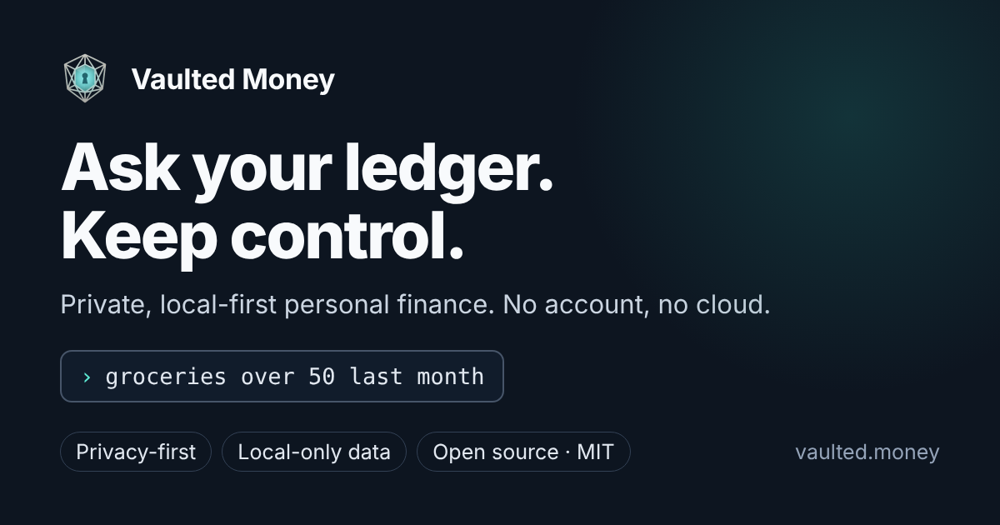
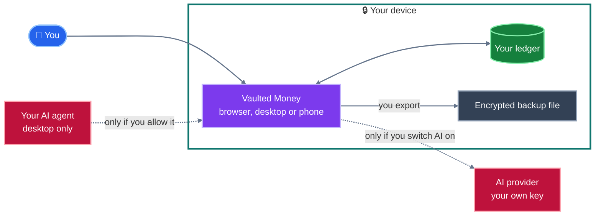

<p align="center">
  <a href="https://vaulted.money/ledgers?demo=1"></a>
</p>

<h1 align="center">Vaulted Money</h1>

<p align="center">
  <b>A money tracker that lives on your device, not on someone else's server.</b><br/>
  No account. No cloud. Open source. Search it in plain English, with no AI needed.
</p>

<p align="center">
  <a href="https://vaulted.money/ledgers?demo=1"><b>▶ Try it with demo data</b></a>
  &nbsp;·&nbsp;
  <a href="marketing/search-demo/final/vaulted-money-search.mp4">Watch the search demo</a>
  &nbsp;·&nbsp;
  <a href="documentation/GETTING_STARTED.md">Getting started</a>
  &nbsp;·&nbsp;
  <a href="documentation/README.md">All docs</a>
</p>

[](https://app.circleci.com/pipelines/github/nrajesh/vaulted.money)
[](https://github.com/nrajesh/vaulted.money)
[](https://opensource.org/licenses/MIT)


## How It Differs

| | Most finance apps | Vaulted Money |
| --- | --- | --- |
| 🔒 **Where your data lives** | On the company's servers | On your device. It leaves only when you export it. |
| 👤 **Signing up** | Email, password, often a bank login | Nothing. Open it and start. |
| 🔎 **Finding things** | Filters and dropdowns | Type "groceries over 50 last month". No AI or cloud involved. |
| 🤖 **AI** | Increasingly built in by default | Off until you switch it on, with your own key or your own agent. |
| 🧰 **Automation** | Rarely scriptable | A desktop Local API with OpenAPI and a Postman collection. |
| 📖 **Trust** | Take their word for it | Read the code. MIT licensed. |

## How It Works, In One Picture



Solid arrows always happen. Dotted arrows happen only after you switch something on. There is no Vaulted Money server in the picture because there isn't one. More diagrams are in [Architecture](documentation/ARCHITECTURE.md).

## What Is Vaulted Money?

Vaulted Money is a personal finance app you run on your own device. You create a ledger, add or import transactions, group them into accounts and categories, set budgets, and review reports.

The important bit: your data stays local by default. There is no hosted Vaulted Money account, no central database, and no subscription wall around basic budgeting.

## Who Is It For?

- People who want a simple private place to track income, expenses, accounts, and budgets.
- People who are uncomfortable uploading bank exports to a cloud finance service.
- Developers and self-hosters who want an auditable local-first finance app.
- Families, freelancers, or small projects that want separate ledgers for different money contexts.

## What Can It Do?

| Area         | Plain-English Meaning                                                |
| ------------ | -------------------------------------------------------------------- |
| Ledgers      | Keep separate money books, such as Personal, Business, or Joint.     |
| Transactions | Record money coming in or going out.                                 |
| Accounts     | Track where money lives, such as checking, savings, cash, or credit. |
| Categories   | Understand what the money was for.                                   |
| Budgets      | Set limits or goals and see progress.                                |
| Imports      | Bring in bank CSV exports.                                           |
| Search       | Type a sentence such as "groceries over 50 last month" and pick what it understood. |
| Reports      | See income, spending, net worth, trends, and summaries.              |
| Backups      | Export your data as JSON, with encrypted backup options.             |
| Optional AI  | Bring your own API key to help categorize transactions.              |

## Quick Setup

You need three tools first:

- [Node.js](https://nodejs.org/) 18 or newer
- [pnpm](https://pnpm.io/) 8 or newer
- [Git](https://git-scm.com/)

Then run:

```bash
git clone https://github.com/nrajesh/vaulted.money.git
cd vaulted.money
pnpm install
pnpm dev
```

Open [http://localhost:8081](http://localhost:8081) in your browser.

For the desktop app:

```bash
pnpm run electron:dev
```

That starts the local web app, compiles the Electron files, and opens the desktop window.

## Read Next

The README is intentionally short. Use these pages for the details, or open the [documentation map](documentation/README.md) to see every page and how they connect.

| Page                                                           | Best For                                                                         |
| -------------------------------------------------------------- | -------------------------------------------------------------------------------- |
| [Getting Started](documentation/GETTING_STARTED.md)            | A non-technical first run and first ledger walkthrough.                          |
| [Setup and Builds](documentation/SETUP.md)                     | Full web, desktop, Android, iOS, and release commands.                           |
| [User Guide](documentation/USER_GUIDE.md)                      | What the app does and how to use the main workflows.                             |
| [Developer Guide](documentation/DEVELOPER_GUIDE.md)            | Project structure, quality checks, AI provider notes, and contribution workflow. |
| [Local API](documentation/API.md)                              | Desktop REST API for scripts: manage data and generate reports and backups.      |
| [API cookbook](documentation/API_COOKBOOK.md)                  | Recipes for using the app without the GUI, and for building your own interface.  |
| [Architecture](documentation/ARCHITECTURE.md)                  | How it fits together, in pictures, starting with a 60-second version.            |
| [Documentation map](documentation/README.md)                   | Every page, who it is for, and how they link to each other.                      |
| [Why Vaulted Money Exists](documentation/WHY_VAULTED_MONEY.md) | Motivation, privacy stance, and project philosophy.                              |
| [Support](documentation/SUPPORT.md)                            | How to get help.                                                                 |

## Using the Local API (desktop)

The desktop app can expose a REST API on your own computer, so scripts and tools can manage your ledgers, accounts, transactions, recurring transactions, budgets, categories, vendors, currencies, languages and AI providers, and generate analytics, insights, reports and backups. It is off by default, listens on `127.0.0.1` only and needs a token. The web and mobile apps do not have it.

1. Open **Settings**, scroll down to the **Local API** card (desktop app only), switch it on, and copy the token.
2. Call it with any HTTP client:

```bash
export VM="http://127.0.0.1:47821/api/v1"
export VM_TOKEN="<token from settings>"
AUTH="Authorization: Bearer $VM_TOKEN"

# list ledgers, then add a transaction to one
curl -H "$AUTH" $VM/ledgers
curl -H "$AUTH" -H "Content-Type: application/json" -X POST $VM/ledgers/$LEDGER/transactions \
  -d '{"date":"2026-01-15","amount":-42.5,"account":"Checking","vendor":"Grocer","category":"Food"}'

# download a CSV report and a password-protected backup
curl -H "$AUTH" -OJ "$VM/ledgers/$LEDGER/reports/income-expense?format=csv"
curl -H "$AUTH" -H "Content-Type: application/json" -X POST -OJ $VM/backups/export \
  -d '{"password":"a long passphrase"}'
```

`GET $VM` lists every endpoint. The app must be running (closing the window only hides it). Restoring a backup replaces data and needs `"confirm_replace": true`.

Beyond basic data entry the API covers the app's clean-up tools (detect transfers, remove duplicates, categorize, reconcile balances, merge and clean up accounts/vendors/categories), CSV import and export, settings, and an OpenAPI description at `GET $VM/openapi.json` for generating your own client. The full guide, with every endpoint, filters, error format and the security model, is in [Local API](documentation/API.md); [recipes for scripts, month-end routines and building your own interface](documentation/API_COOKBOOK.md) are in the cookbook. Scripts can also hand the API a plain sentence: `GET $VM/ledgers/$LEDGER/search/interpret?q=starbuks over 20 last month` returns the same structured filters the app's search box builds, plus the matching transactions query. To try it from Postman, import the [ready-made collection](documentation/postman/README.md).

## Use with an AI agent

You can let an AI agent such as Claude read your money manager and help with it, for example "Where is my money going this month?" or "Import this bank statement". The desktop app must be running (closing the window only hides it). Setup is one switch.

1. Open **Settings → Local API → Connect an AI agent** (opens the Connect to agent page) and switch on **Allow agents to connect**. The app tells agents how to find it, so there is no token to copy.
2. Then pick your agent:

- **Claude Desktop:** download `vaulted-money.mcpb` from the [Releases page](https://github.com/nrajesh/vaulted.money/releases), double-click it and confirm the install. Nothing else is needed, not even Node.js.
- **Claude Code:** on the Connect agent page, choose **Claude Code** and click **Set up Claude Code for me**. The app finds Claude Code on your computer and sets the plugin up (or updates it), and links to the download if it is not installed. Prefer to do it yourself? Paste this into a normal terminal (needs [Node.js](https://nodejs.org/) 18 or newer), or run the two `/plugin` commands inside Claude Code:

  ```
  claude plugin marketplace add nrajesh/vaulted.money
  claude plugin install vaulted-money@vaulted-money
  ```

  Inside Claude Code the same two steps are `/plugin marketplace add nrajesh/vaulted.money` and `/plugin install vaulted-money@vaulted-money`.

- **Codex:** on the Connect agent page, choose **Codex** and click **Set up Codex for me**. The app finds Codex on your computer and registers the server with it (needs [Node.js](https://nodejs.org/) 18 or newer). Not installed yet? The page shows the install command (`npm install -g @openai/codex`). Prefer to do it yourself? Use **Copy config** and paste it into `~/.codex/config.toml`.
- **A local model (for example LM Studio):** use **Copy setup** under **A private model on this computer** and paste it into the app's `mcp.json`. Choose a model that supports tool calling. Needs Node.js 18 or newer.

**Privacy, honestly.** The plugin and the server upload nothing. But when you ask a question, whatever the agent reads to answer it, such as transactions, vendors and balances, is sent to the AI provider (Anthropic, for Claude). Only ask about data you are happy to share that way. A local model keeps everything on your device. The claude.ai website is not supported, because it cannot reach software on your computer.

**Staying safe.** Keep your agent's approval prompts switched on for adding, deleting and importing. Deletions need an explicit confirmation, and it is wise to make a backup before you let an agent work on real data. **Disconnect everything** in the same panel switches the Local API off and replaces the token, which cuts off every connected agent and script until you switch the Local API on again. They then reconnect on their own, with no copy-paste. More detail is in the [MCP server guide](mcp/README.md).

## Support the Project

Vaulted Money is free and open-source under the MIT license. If you find it useful and want to support development, you have several options:

| Channel                                                          | Status      |
| ---------------------------------------------------------------- | ----------- |
| Buy on Apple App Store (€9.99 one-time)                          | Coming soon |
| Buy on Google Play Store (€9.99 one-time)                        | Coming soon |
| Buy desktop binary on Lemon Squeezy or Polar.sh (€9.99 one-time) | Coming soon |
| [GitHub Sponsors](https://github.com/sponsors/nrajesh)           | Active      |
| PayPal / direct transfer (see in-app Donation page)              | Active      |

The same app is free to build from source, regardless of which channel you choose. Store purchases exist to make installation simpler for non-technical users and to support continued development.

## Privacy In One Paragraph

Vaulted Money stores financial data in your browser or local app storage. Nothing is sent to a Vaulted Money server because there is no Vaulted Money server. If you enable optional AI categorization, only the data needed for that action is sent to the provider you configure with your own API key. If you connect an AI agent, what the agent reads is sent to that agent's provider (see [Use with an AI agent](#use-with-an-ai-agent)). Because the app is local-first, backups are your responsibility.

## License

Vaulted Money is released under the [MIT License](LICENSE).

Made for calmer, more private money management.
