# Architecture

How Vaulted Money is put together, starting with the picture a non-developer needs and getting more technical as you scroll.

**On this page**

| If you want to know… | Read |
| --- | --- |
| Where my data lives and who can see it | [The 60-second version](#the-60-second-version) |
| How one codebase becomes a web, desktop and phone app | [One app, three shells](#one-app-three-shells) |
| What happens when I add a transaction | [Data flow](#data-flow) |
| How search understands a sentence | [Search](#search) |
| How scripts and AI agents talk to the app | [Local API](#local-api-desktop-only) and [AI & agents hub](#ai--agents-hub) |
| Why it was built this way | [Architectural decisions](#architectural-decisions) |

**Colour key used in every diagram**

| Colour | Means |
| --- | --- |
| 🟦 Blue | What you see: screens and windows |
| 🟪 Purple | App logic |
| 🟩 Teal and green | The data layer, and data stored on your device |
| 🟧 Amber | The desktop or phone shell |
| 🟥 Red | Outside your device, reached only if you opt in |
| ⬛ Slate | Files and build outputs |

---

## The 60-second version

Most finance apps are a thin screen in front of somebody else's database. Vaulted Money is the opposite: the whole app, and the only copy of your data, sit on your own device. There is no Vaulted Money server to send anything to.

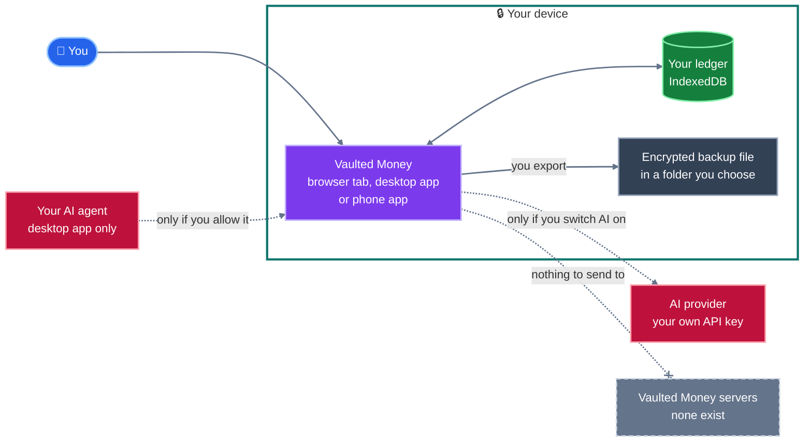

Solid arrows always happen. Dotted arrows happen only after you switch something on.

---

## One app, three shells

> **In plain words:** the app is written once, as a web page. The desktop and phone versions are that same web page wrapped in a thin "shell" that gives it a window, an icon and access to files.

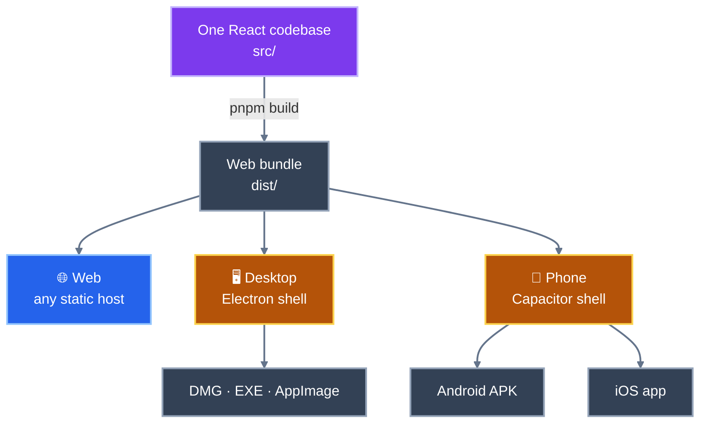

Every command and the file it produces is drawn in [Setup and Builds](SETUP.md#what-each-command-builds).

### Inside the browser

> **In plain words:** a stack of layers. You touch the top one; your data sits in the bottom one. Each layer only talks to its neighbours.

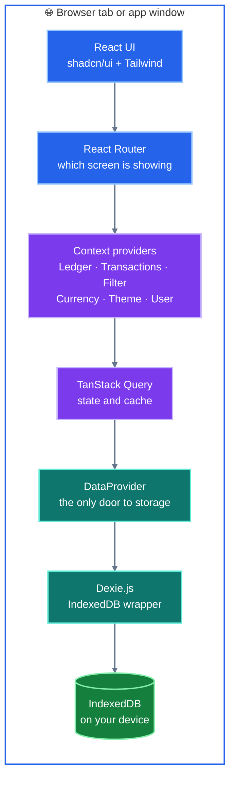

### Routes

The application uses `react-router-dom` with two distinct route trees:

| Route | Component | Needs an open ledger? | Purpose |
|---|---|---|---|
| `/` | `HomePage.tsx` | No | Public landing page: trust signals, install commands, backup guidance, links to `/ledgers` |
| `/ledgers` | `LedgerEntryPage.tsx` | No | Ledger selector, the entry point to the app |
| `/dashboard`, `/transactions`, `/budgets`, etc. | `Layout` (nested) | Yes | Dashboard, transactions, budgets, reports, settings |

On Electron and Capacitor, the app uses `HashRouter` so native shells can boot directly into `/#/ledgers` without server-side route handling. The browser build uses `BrowserRouter`.

`HomePage.tsx` lives outside the `Layout` route so it never triggers the active-ledger redirect. It retains the language switcher and light/dark toggle but has its own header rather than the app sidebar.

### The desktop shell (Electron)

> **In plain words:** the desktop app is a private browser window plus a small helper program. The window shows the app; the helper is the only part allowed to touch your files, and the window has to ask it politely.

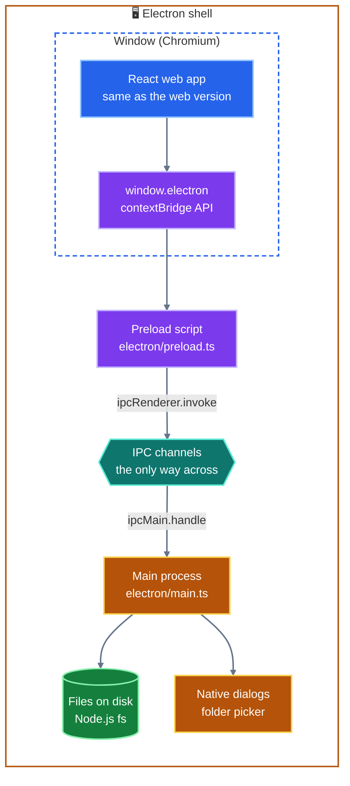

The main process checks every file request: the filename is reduced to its base name, the extension must be on an allowlist, and the folder must be one the user picked in a dialog.

### The phone shell (Capacitor)

> **In plain words:** on a phone the same web bundle runs inside the system's built-in web view. Capacitor plugins stand in for the things a browser cannot do, such as saving a backup to the Documents folder.

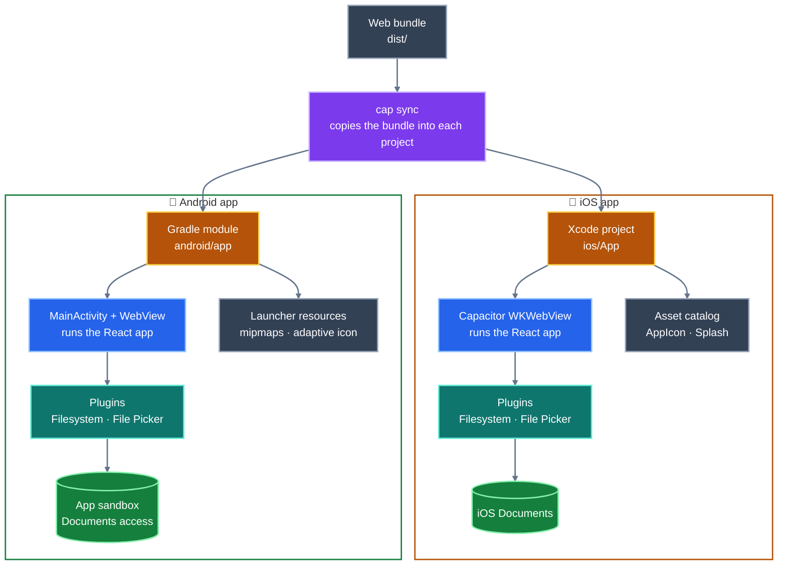

Native builds use `HashRouter`. Platform rules live in [IOS_RULES.md](IOS_RULES.md) and [ANDROID_RULES.md](ANDROID_RULES.md).

#### Refreshing icons and splash screens

Phones cache launcher icons aggressively, so a changed icon needs a clean reinstall.

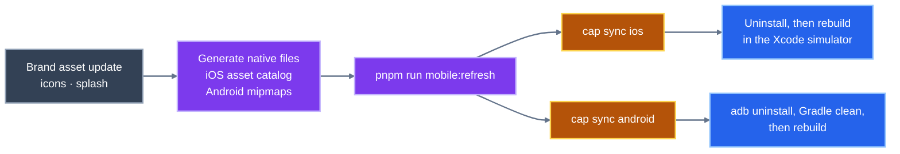

### One way to save a file, three engines

> **In plain words:** "save this backup" means something different in a browser, on a desktop and on a phone. The app asks one adapter, and the adapter picks the right engine.

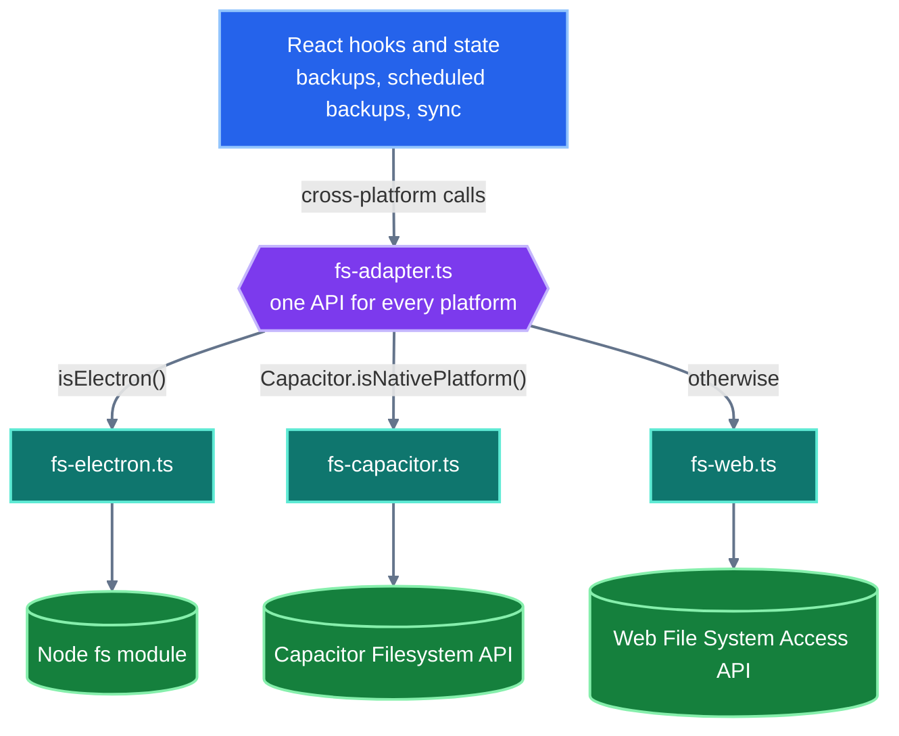

---

## Data flow

> **In plain words:** when you add a transaction the screen updates at once, then the app writes it to your device and re-reads it to be sure the screen and the stored copy agree. Nothing in this loop leaves the device.

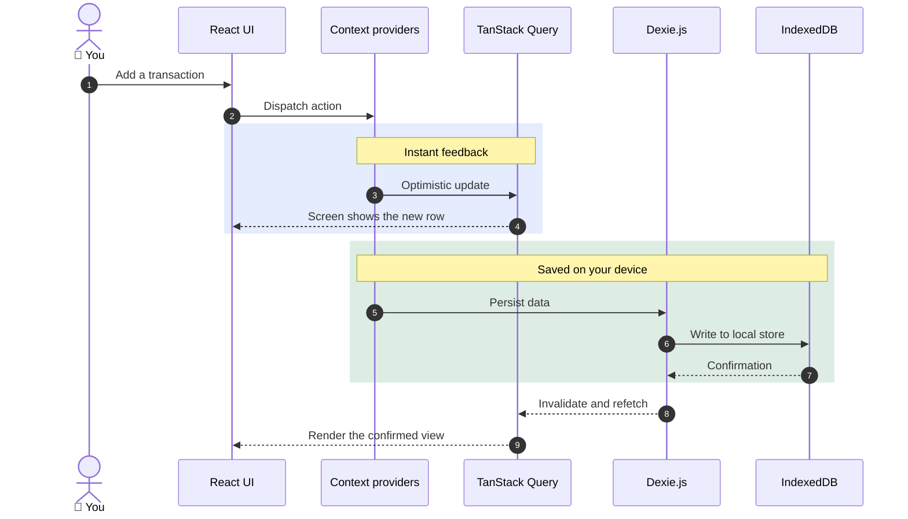

Names act as links between records: a transaction stores the vendor, account and category *names*. Renames and deletes therefore go through `DataProvider` methods that update every record holding the name, inside one ledger and one database transaction.

---

## Search

> **In plain words:** type "groceries over 50 last month" and the app works out that you mean a category, an amount and a date range. This is ordinary code reading the sentence, not AI, so it works offline and gives the same answer every time.

One parser reads every typed query, whichever screen or channel it comes from:

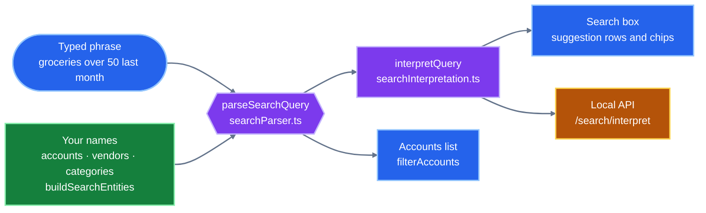

- `src/utils/searchParser.ts` turns text into a filter: dates (relative, ranges, "since", "2 weeks from today", year or month first), amounts, income/expense, "top N", and names. Names match exactly, then by singular/plural, then (only when the caller shows the result for confirmation) with typos, using `src/utils/fuzzyMatch.ts`.
- `src/utils/searchInterpretation.ts` splits the result into pieces the user can accept one at a time, and describes it as plain JSON for the API. The search box and the API both call `interpretQuery`, so they cannot disagree.
- `src/utils/searchFilters.ts` applies the text part (word by word) and the Accounts-list search. There is no second parser.
- Filters combine with AND across kinds; several values of one kind match either.
- Typo matching is off unless asked for, so a screen that applies results as you type never guesses.

---

## Local API (desktop only)

> **In plain words:** the desktop app can open a private door on your own computer so your scripts can read and change your ledger. The door is closed until you open it, only answers programs on the same computer, and needs a password (a token).

The data lives in the window's IndexedDB, so the main process owns only the network socket and relays each request to the window, which runs it against the same data layer the screens use. See [API.md](API.md) for the endpoint reference.

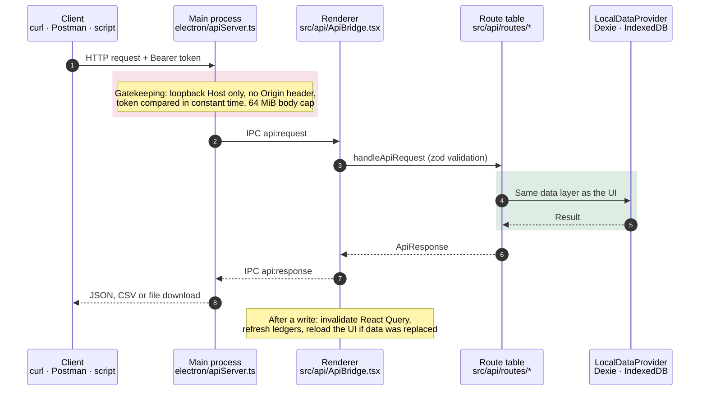

Key points:

- **Off by default.** The user turns it on in Settings, which stores the port and a generated token in `api-config.json` (mode `0600`) under the app data folder.
- **Loopback only, no browser access.** Requests carrying an `Origin` header are refused, so web pages cannot call it.
- **One route table.** `src/api/routes/index.ts` is the source of truth for the router, the generated `/openapi.json`, and the Postman coverage test.
- **Shared logic with the UI.** Searching is one of these: `GET /ledgers/{id}/search/interpret` calls the same `interpretQuery` as the search box (see [Search](#search)). Renames, transfer detection, duplicate detection and AI categorization live in shared code (the rename and delete methods on `DataProvider`, `src/utils/transactionMaintenance.ts`, `useAutoCategorize`) so the UI and the API behave the same.
- **Safe by default.** Secrets (AI keys, backup password hashes) are never returned. Deletions need `confirm_delete`, restores need `confirm_replace`, bulk operations support `dry_run`, and AI use is opt-in per request.
- **Not available on web or mobile**, which cannot host a local server.

---

## AI & agents hub

> **In plain words:** AI is a single switch, and it starts off. Switching it off also shuts the door that agents use.

One sidebar entry, **AI & agents**, opens one page (`src/pages/AiHubPage.tsx`) with two sections: **AI inside the app** (bring-your-own-key or local-model categorization) and **Chat with your data from an AI agent** (Claude, Codex or a local model, plus the Local API controls). `/ai-providers` and `/connect-agent` both show it; the second scrolls to the agent section. The page reads the Local API status once (`useLocalApi`) and shares it with both the agent steps and the Local API card.

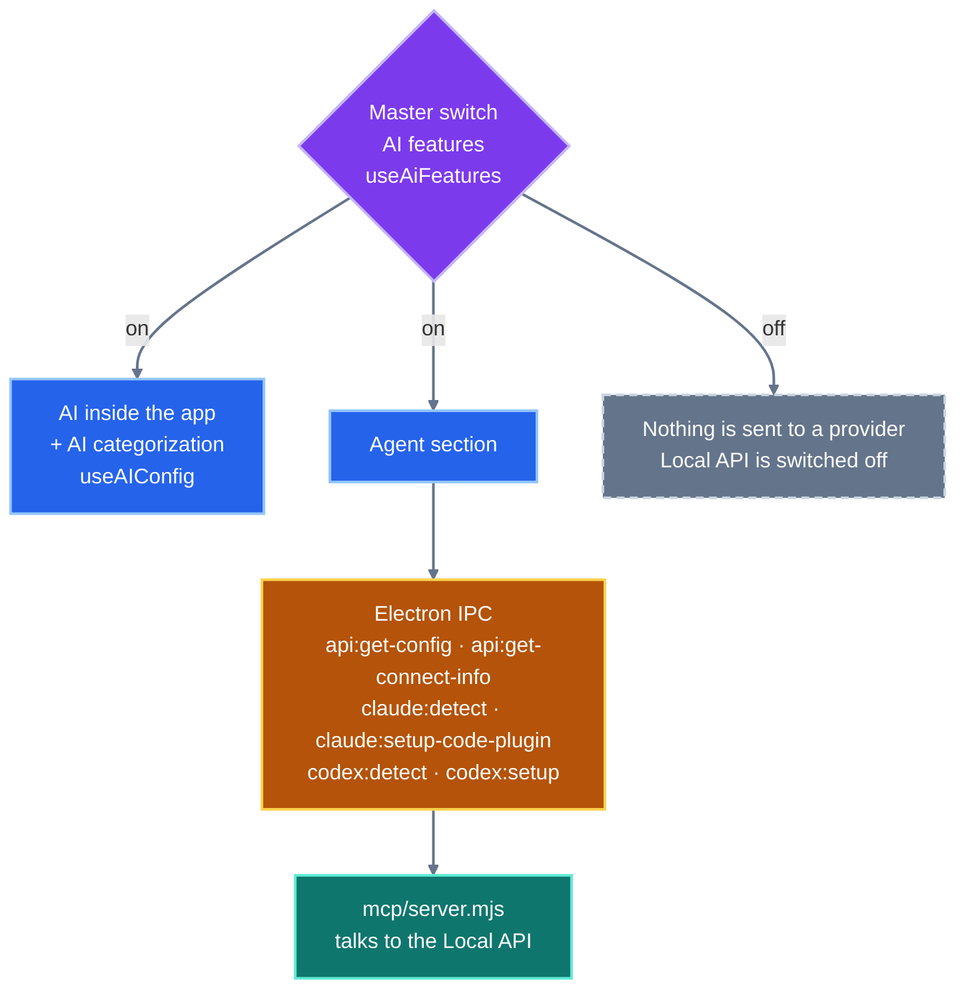

- **The master switch is a per-device privacy choice**, not ledger data, so it lives in `localStorage` (`vaulted.aiFeatures`). Until the user chooses, it follows what they already use: on if an AI provider exists or the Local API is enabled, off on a fresh install. Switching it off also closes the Local API to agents (`setApiConfig`). With it off, the hub shows only the switch.
- **Connect agent needs the desktop app.** Agents reach the app through the Local API and the MCP server, which only the desktop build can host. The steps show only where the Electron bridge exists (`getApiConfig`); on the web and mobile the section says the Local API needs the desktop app.
- **Setup runs in the main process.** The page asks Electron to detect Claude Code or Codex and set them up, and shows copyable configuration for Claude Desktop (`.mcpb`) and local models such as LM Studio.
- The same tools an agent uses are described in [mcp/README.md](../mcp/README.md); the endpoints behind them in [API.md](API.md).

### AI auto-categorization (bring your own key)

> **In plain words:** if you ask for it, the app sends vendor names and your category list straight from your device to the AI company you chose, using your own key. There is no Vaulted Money server in the middle to keep a copy.

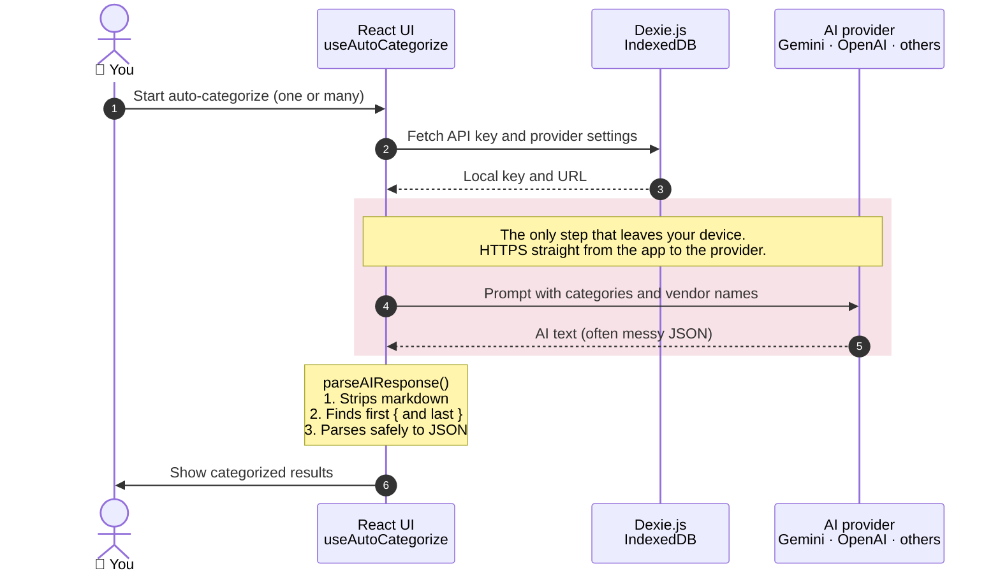

---

## Architectural decisions

Each entry records why something was built the way it was, and what it cost.

- **[2026-10] Opt-in local REST API served by the Electron main process**
    - **Context**: Users want to script the app, import and export data without the GUI, and build their own interfaces. All data lives in the renderer's IndexedDB, which the main process cannot read.
    - **Decision**: The main process hosts a loopback-only HTTP server and relays requests over IPC to the renderer, which executes them against the same data layer as the UI. It is off by default and protected by a bearer token.
    - **Consequences**:
        - **Pros**: No second data store to keep in sync. UI and API behave identically. The API itself sends nothing off the machine; an AI agent connected to it sends what it reads to its AI provider, unless it is a local model.
        - **Cons**: The app window must be running (the API answers `503 ui_not_ready` otherwise). Desktop only. The API is a public contract, so changes must update tests, docs and the Postman collection (see `documentation/CLAUDE.md`).
- **[2024-03] Direct browser-to-AI-provider communication**
    - **Context**: We want users to be able to use AI features without creating a centralized backend that could store their API keys or financial data, maintaining the "local-first" privacy ethos.
    - **Decision**: Implemented BYOK (Bring Your Own Key) where the React app communicates directly with AI provider APIs (Gemini, Anthropic, Mistral, etc.).
    - **Consequences**:
        - **Pros**: Complete privacy for the user. No backend infrastructure required. Zero server costs.
        - **Cons**: Susceptible to CORS issues with certain providers if they don't allow browser requests, requiring users to sometimes handle configuration quirks.
- **[2024-03] Robust client-side JSON parsing for AI outputs**
    - **Context**: Different AI models have wildly varying tendencies to wrap requested JSON in markdown or add conversational fluff ("Sure, here is your JSON:").
    - **Decision**: Added a central `parseAIResponse` utility that manually extracts substrings between `{` and `}` if standard `JSON.parse` fails.
    - **Consequences**: Reduces the rate of categorization failures significantly across different LLM providers without needing complex prompt engineering for every single model type.

<!--
Template for a new entry:

- **[YYYY-MM] Decision title**
    - **Context**: Why was this decision needed?
    - **Decision**: What was decided?
    - **Consequences**: What are the pros and cons?
-->
