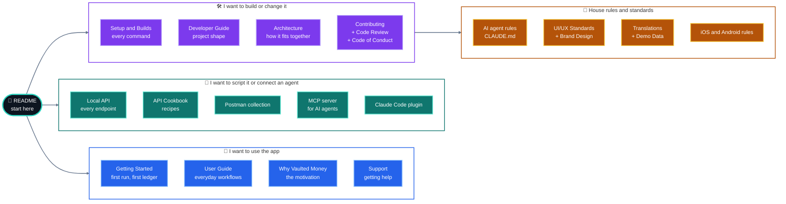
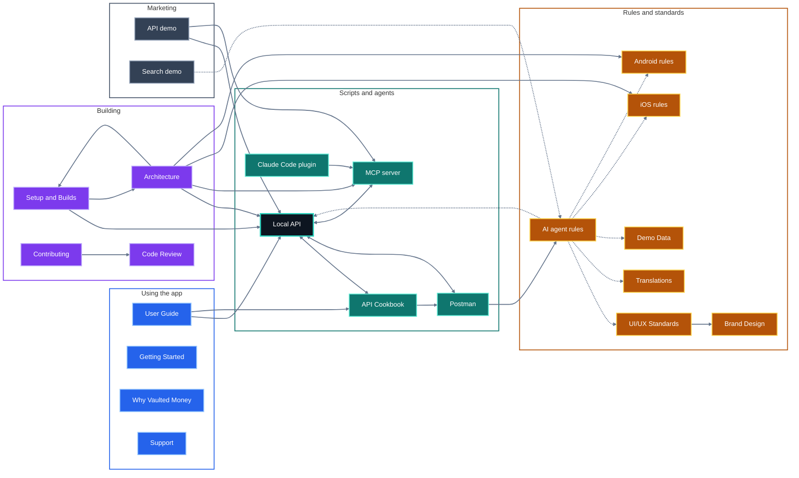

# Documentation map

There are a lot of Markdown files in this repository. This page shows what each one is for, who it is written for, and how they point at each other.

## Pick your path

## Every page, by reader

### Using the app

| Page | What you get |
| --- | --- |
| [README](../README.md) | What the app is, a quick setup, and how to connect an AI agent. |
| [Getting Started](GETTING_STARTED.md) | A non-technical first run and first ledger. |
| [User Guide](USER_GUIDE.md) | The main workflows, screen by screen. |
| [Why Vaulted Money Exists](WHY_VAULTED_MONEY.md) | Motivation and privacy stance. |
| [Support](SUPPORT.md) | How to get help. |

### Scripting it and connecting agents

| Page | What you get |
| --- | --- |
| [Local API](API.md) | Reference for the desktop REST API: endpoints, filters, errors, security model. |
| [API Cookbook](API_COOKBOOK.md) | Recipes: month-end routines, using the app without the GUI, building your own interface. |
| [Postman collection](postman/README.md) | A ready-made collection that doubles as the API's test suite. |
| [MCP server](../mcp/README.md) | How an AI agent (Claude, Codex, a local model) reaches your ledger. |
| [Claude Code plugin](../plugins/vaulted-money/README.md) | The plugin and its skills (budget check, bank CSV import, spending review). |

### Building and changing it

| Page | What you get |
| --- | --- |
| [Setup and Builds](SETUP.md) | Every install, run and build command, with a picture of what each one produces. |
| [Developer Guide](DEVELOPER_GUIDE.md) | Project structure, quality checks, state and data conventions, deployment. |
| [Architecture](ARCHITECTURE.md) | Diagrams of the web, desktop and phone apps, search, the Local API and AI. |
| [Contributing](../CONTRIBUTING.md) | How to propose a change. |
| [Code Review](CODE_REVIEW.md) | What reviewers look for. |
| [Code of Conduct](../CODE_OF_CONDUCT.md) | How we treat each other. |
| [Security policy](../.github/SECURITY.md) | How to report a vulnerability. |

### House rules and standards

| Page | What you get |
| --- | --- |
| [AI agent rules](CLAUDE.md) | The rules an AI coding agent must follow here, and the lessons behind them. Useful for humans too. |
| [UI/UX Standards](UI_UX_STANDARDS.md) | Layout, contrast and interaction rules. |
| [Brand Design](DESIGN.md) | Logo geometry, colours and icon usage. |
| [Translations](I18N.md) | How text is translated into the five shipped languages. |
| [Demo Data](DEMO_DATA.md) | What "Generate demo data" creates and how to extend it. |
| [iOS rules](IOS_RULES.md) and [Android rules](ANDROID_RULES.md) | Platform-specific constraints. |
| [Migration Specs](MIGRATION_SPECS.md) | Notes for data migrations. |

### Behind the scenes

| Page | What you get |
| --- | --- |
| [Search demo video](../marketing/search-demo/README.md) | How the natural-language search video is recorded. |
| [API demo video](../marketing/api-demo/README.md) | How the Local API video is rendered. |
| [Launch kit](../marketing/LAUNCH_KIT.md) | Ready-to-post announcement copy and listing sites. |
| [`specs/`](../specs) | One folder per feature: the original spec and plan, kept as a history of decisions. |

## Which page links to which

Each arrow is a real link inside a page. A dotted arrow is a mention by file name without a link.

Two pages are left out of the picture because they point almost everywhere and would bury it: the **README** links to every page in the first three groups, and the **Developer Guide** links to Architecture, the API pages, the AI agent rules, both design pages, Why Vaulted Money and Support.

Reading the picture: **Local API** (outlined) is the page most others lean on. Getting Started, Why Vaulted Money, Support, Translations, Demo Data and the platform rules are end points: they are linked to, but send you nowhere else. This map is the one place that lists them all.

## How commands turn into files

The build picture, command by command, lives in [Setup and Builds](SETUP.md#what-each-command-builds).
