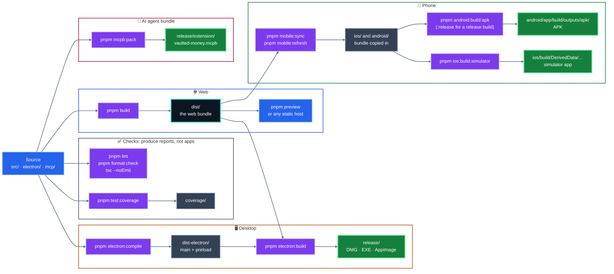

# Setup And Builds

This page collects the full setup, run, build, mobile, and release commands. To see how the pieces fit together first, read [Architecture](ARCHITECTURE.md); for a picture of what every command produces, jump to [What each command builds](#what-each-command-builds).

## Prerequisites

| Requirement | Version | Install |
| --- | --- | --- |
| Node.js | 18+ | [Download Node.js](https://nodejs.org/) or use `nvm install 18`. |
| pnpm | 8+ | `npm install -g pnpm` |
| Git | Any recent version | [Download Git](https://git-scm.com/) |

The project uses `pnpm-lock.yaml`, so pnpm is the expected package manager.

## Install

```bash
git clone https://github.com/nrajesh/vaulted.money.git
cd vaulted.money
pnpm install
```

Optional verification:

```bash
pnpm lint
pnpm build
```

## Web App

```bash
pnpm dev
```

Open [http://localhost:8081](http://localhost:8081), or the port printed by Vite.

## Electron Desktop App

```bash
pnpm run electron:dev
```

This command:

1. Starts the Vite dev server on port `8081`.
2. Waits for the server to be ready.
3. Compiles the Electron main and preload files.
4. Launches the Electron window.

To use the optional Local API, turn it on in Settings inside the desktop app. After pulling changes that touch `electron/`, fully quit the app (closing the window only hides it) and run `electron:dev` again so the main process is recompiled. See [API.md](API.md).

Do not run `pnpm dev` separately before `electron:dev`; that can create a port conflict.

The first Electron run may take longer because the Electron binary is downloaded.

## What Each Command Builds

Everything starts from one web bundle. Desktop and phone builds wrap that same bundle, which is why they all begin with `pnpm build`.



Purple boxes are commands, grey boxes are folders they create along the way, and green boxes are the finished things you can install. None of these folders are committed to git; each can be recreated by running its command.

Two shortcuts chain several of these together:

- `pnpm validate` runs the type check, lint and format check.
- `pnpm release:local` runs the desktop package, the Android debug APK and the iOS simulator build in one go.

## Build Commands

| Goal | Command | Output |
| --- | --- | --- |
| Web production build | `pnpm build` | `dist/` |
| Web local preview | `pnpm build` then `pnpm preview` | Local preview server |
| Electron packages | `pnpm run electron:build` | `release/` |
| Electron dev | `pnpm run electron:dev` | Local desktop window |
| Sync mobile shells | `pnpm run mobile:sync` | Copies web build to native shells |
| Refresh both mobile apps | `pnpm run mobile:refresh` | Builds web and syncs iOS/Android |
| Android debug APK | `pnpm run android:build:apk` | `android/app/build/outputs/apk/debug/` |
| Android release APK | `pnpm run android:build:apk:release` | `android/app/build/outputs/apk/release/` |
| iOS simulator app | `pnpm run ios:build:simulator` | `ios/build/DerivedData/Build/Products/Release-iphonesimulator/` |
| Full local release sweep | `pnpm run release:local` | Electron package, Android debug APK, iOS simulator build |

Electron packaging depends on a fresh web build because the renderer ships from `dist/`.

Capacitor mobile builds also depend on a fresh web build because `cap sync` copies `dist/` into the native iOS and Android projects.

## Mobile Refresh

Use this whenever web assets, native icons, or Capacitor configuration change:

```bash
pnpm run mobile:refresh
```

That runs:

```bash
pnpm run build
pnpm exec cap sync ios
pnpm exec cap sync android
```

## Clean Reinstall On Simulators

iOS:

```bash
xcrun simctl uninstall booted com.vaultedmoney.app || true
pnpm exec cap open ios
```

Then in Xcode:

1. Product > Clean Build Folder
2. Product > Run

Android:

```bash
adb uninstall com.vaultedmoney.app || true
cd android
./gradlew clean
pnpm exec cap open android
```

Then in Android Studio:

1. Let Gradle sync.
2. Run the `app` target again.

Use the clean reinstall flow after icon updates. iOS and Android can cache launcher assets aggressively.

## GitHub Release Assets

Publishing a GitHub release keeps GitHub's default source ZIP/TAR assets and also uploads:

- macOS Electron DMG
- Android release APK
- unsigned iOS simulator app ZIP

The iOS artifact is a simulator build. A device-installable IPA requires Apple signing certificates and provisioning profiles.

## Troubleshooting

If `pnpm install` fails:

```bash
rm -rf node_modules
pnpm install
```

If Electron fails because port `8081` is busy, stop the other process and rerun:

```bash
pnpm run electron:dev
```
